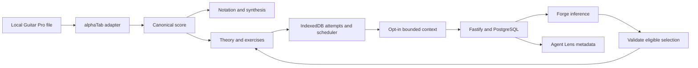

# Architecture

TabToPitch has a local application and an optional coaching service. The browser owns the score, playback, grading, attempt history, and scheduling. The service owns invitation access, session revocation, inference budgets, and bounded cloud recommendations.

## Musical identity and time

`src/engine/types.ts` defines source notes, sounding pitches, written spelling, physical positions, independent articulations, exercises, and immutable attempt records. The adapter preserves string order and obtains concert pitch from alphaTab's technique-aware calculation. It does not reconstruct harmonics with tuning plus fret.

Stable structural note IDs are scoped by the source document hash. Notation ticks describe written measures. Playback occurrences describe traversal through repeats and alternate endings; `src/player/timeline.ts` translates between them. A tie continuation remains a source event while the attack's sounding duration spans its tie chain. Layout bounds belong to alphaTab's current render and never define musical identity.

The source-note exercise layer accepts an inferred triad only when supported overlapping notes establish one unambiguous major or minor identity. The progression engine separately recognizes 24 supported chord families, retains multiple exact-set interpretations, and requires confirmed chord context before generating a progression or extended chord-role question. The adapter accounts for staccato shortening and rejects an attack for exercises if its tied continuation changes pitch through an unsupported technique. Let-ring, palm-mute, and custom-duration timing remain unqualified; a track containing them withholds chord analysis rather than asserting an inaccurate overlap. Its stable notes can still support pitch and location questions. Imported spelling is preserved when evidence exists. Chromatic pitches lacking validated spelling cannot become interval questions.

## Fretboard exploration

`src/engine/exploration.ts` owns note-location matching and derived triad voicings. Note matching defaults to pitch class across octaves; exact concert pitch is an explicit option. Searches preserve physical string order, apply capo once, and stay within frets 0 through 24. The inspector only maps supported ordinary fretted notes. It does not reconstruct harmonic or bent-note fingering.

Triad enumeration uses adjacent three-string groups by default or an explicit group of three distinct strings. Every candidate contains one root, third, and fifth. Its inversion and slash-chord label come from the lowest sounding MIDI pitch, including under reentrant tuning. The default four-fret span applies to fretted notes; open strings do not contribute. Results are ordered by their highest fret, fretted span, then physical coordinates. This bounds the search without claiming ergonomic validation or a CAGED classification. Chord spellings retain the correct written octave at enharmonic boundaries.

The inspector separates note matching from chord exploration and auditions derived shapes without modifying source events. Its practice handoff starts a guided question. Exploration views are not attempt evidence; held-back checks only account for recorded answer attempts, as described in [the curriculum](curriculum.md).

## Progression studies

`src/engine/harmony.ts` owns chord formulas and spelling, harmonic spans, key/mode collections, bounded voicing enumeration, and path ranking. The supported families include triads, suspended and power chords, sixths, sevenths, added ninths, ninths, minor elevenths, and major/dominant thirteenths. Exact sounding sets can have multiple interpretations. Inference offers suggestions; imported symbols and manually entered symbols retain their provenance. The original lesson has authored confirmed harmony. User confirmation is required for imported or inferred harmony before it becomes an arrangement premise.

The shared `useProgressionSession` controller serves `ProgressionStudio` and teacher actions. It accepts up to eight bars and eight harmonic spans on a supported six-string track. A one-chord-per-bar grid lets the player supply harmony for an arpeggiated passage without claiming that the notes at a bar boundary establish its chord. `harmony.worker.ts` runs generation off the UI thread. Replies carry request IDs, and obsolete replies cannot replace the current controls' result.

Move preserves the confirmed chord identities. Color changes select within supported major, minor, or dominant families and list omitted degrees. A substitution requires a confirmed major key and the engine's matching function category; it remains a listening comparison whose suitability depends on the melody and phrase. Neither shared notes nor a fretboard position proves harmonic function.

Candidate generation enforces tuning, capo, fret bounds, available strings, two to six voices, bass constraints, optional open strings, optional fifth omission, and explicit rootless context. Extended-chord identity tones remain required. Open strings do not expand the four-fret fretted span. A missing candidate reports no match without relaxing the controls. Search limits and candidate caps can truncate results; the engine never claims exhaustive global optimality.

Keeping the chord's bass constrains the lowest guitar note to the confirmed slash-bass pitch class, or the root when no slash bass is given. It does not preserve an exact octave or copy a backing bass line. Other tracks remain unchanged.

Dynamic programming returns up to three paths through the bounded candidates. The cost combines sorted-pitch motion, mean fretted-position movement, top-note movement, and common pitch classes. These are reproducible movement measures, not finger assignments or measured comfort. The learned observed-choice ranker in `research/voicing-ranking/` is not used by this path search. `RecordedChoiceExplorer` offers a separate opt-in, one-change audition using `voicing-ranker.worker.ts`. It ranks candidates matching the actual next source pitch-class multiset and previous source shape. Its bank is capped at 64 before multiset filtering, unlike the research study's complete bounded enumeration. Standard tuning, no capo, stable source shapes, and the model's declared domain are required. Unsupported inputs retain the deterministic path experience. The panel neither applies a progression nor supplies grading answers.

Melody preservation requires an explicitly selected ordinary monophonic voice with nonoverlapping anchors. The generator splits harmonic spans at melody boundaries and requires each anchored MIDI pitch on top for its recorded duration. Unsupported articulation, overlap, or an unavailable voicing is not silently repaired.

`src/player/variation.ts` builds a block-chord accompaniment study on a cloned alphaTab score. It retains master bars, backing tracks, and beat automation; it replaces the selected guitar passage's voices with generated events. This does not preserve the original guitar's strum pattern or articulations. Preview, Original, Apply & save, and Undo use the existing player controller and shared tempo/loop. The immutable imported score remains available throughout. Source-note selection resumes in Original; the variation's diagram exposes its generated notes.

A saved variation records the source hash, track, bar range, confirmations, tonal context, controls, melody selection, engine version, and chosen path ID. Reopening restores the controls and regenerates candidates before another preview. If the old path is unavailable, the UI says so instead of presenting a different path as the saved result. IndexedDB schema version 2 introduced saved variations. Version 3 adds lessons, immutable lesson events, and frozen exercise definitions; backups still accept older records.

The tonal view shows seven explicitly selected modes, their spelled degrees, Roman numerals, and bounded function labels. Changing neck region preserves tonic and mode. Mode audition plays the collection over its tonic. Fifths controls open the original ii–V–I–vi lesson in another major key, transposing guitar and bass together; they do not transpose an imported song.

## Engraving decision

alphaTab 1.8.4 owns import, engraving, synthesis, and transport. The reproducible patch in `scripts/patch-alphatab.mjs` adds serializable label and reserved-width fields to notes, measures them inside `NoteNumberGlyph`, and preserves stock behavior when absent. The optional fret hint is part of the measured display text. A hidden label occupies its reveal width. No SVG text is replaced after layout.

The patch also fixes three reproduced upstream playback defects described in [the patch guide](../patches/README.md). It fails closed on unsupported versions or missing patch anchors. Modified source and notices ship in `/vendor/alphatab-source/`.

## Player ownership

`PlayerController` owns one alphaTab instance, events, worker lifecycle, source lookup, audio state, repeat-aware seeks, loops, responsive notation layout, and disposal. React subscribes to player events; it is not the audio clock. File selection invalidates older pending reads and loads before reading the next file. Replacing a file stops old playback and clears its loop. Resizing or changing labels pauses audio before reflow. Mobile notation scrolls horizontally.

Initial engraving waits for an animation frame queued after alphaTab's constructor. alphaTab installs its viewport reset handler in its own first frame; rendering earlier can leave old score fragments behind. Until initialization completes, the controller retains the latest score, track, and presentation without requesting engraving. A background tab that suspends animation frames therefore leaves the score pending until frames resume. Disposal cancels the pending initialization callback.

Presentation updates apply labels, optional octave numbers, hints, and masks together. Note names are the default; octave display preserves valid imported spelling and cent offsets. The display preference is independent of the advanced octave-grading settings. Practice retains register in interval questions and exact-pitch tasks. Reapplying an identical policy leaves playback running and avoids a redundant render. A candidate score is adapted successfully before it replaces the current document.

The UI adds keyboard transport, semantic previous/next note controls, visible focus, labelled settings, dialogs, and a supplementary fretboard. Responsive layouts mount one inspector or coach panel; a CSS-hidden duplicate must not own another request lifecycle. Practice hides explanatory content until an answer or reveal. Hidden note-name attempts also suppress tuning names; the app owns the tuning strip and disables alphaTab’s duplicate tuning annotation. A request to practice a selected note with no eligible alternative stays in Understand with an explanation rather than selecting another note. Label policy cannot be changed while a question is active. Derived chord audition uses a separate disposable Web Audio voice and never mutates the imported score.

## Local data and offline behavior

IndexedDB stores imported bytes, settings, individual attempts, and saved variation controls. `useLocalData` owns hydration, pending writes, and the distinction between in-memory and saved evidence. A failed save leaves the active session usable and shows an export warning. Normal writes and backup imports both reject attempts to rewrite existing evidence. Backup validation compares schema-normalized records, so JSON property order does not create a false conflict. Restoring progress merges saved records with memory-only attempts. A source file remains the user's durable score backup; the progress JSON contains attempt records and saved variation controls rather than source score bytes.

The production service worker precaches versioned app, worker, worklet, font, and SoundFont assets. Updates are offered to the learner between sessions. API routes are excluded from offline navigation fallback. Stored data is local to this browser profile and origin; private browsing or browser eviction can remove it.

## Cloud boundary

The recall-coach schema in `src/shared/coach.ts` accepts numeric passage features, bounded candidate descriptors, and aggregate evidence. Raw files, title/artist/lyric metadata, audio, and answer keys are excluded. The server further replaces candidate IDs with aliases before inference. The model chooses an eligible candidate; the server builds musical references and factual explanation from validated data.

The UI cancels obsolete requests when consent or practice context changes. A response is checked against the same context before it can appear. The learner starts a proposed exercise before its passage settings take effect. Runtime credentials remain server-side. See [the service contract](../server/README.md) for budgets, trace allowlists, and failure behavior.

The separate arrangement endpoint accepts opted-in request text and normalized musical context: confirmed symbols and durations, tuning/capo, optional key and melody anchors, and bounded controls. It excludes files, filenames, lyrics, and practice history. A model interprets controls and selects an engine-generated candidate; deterministic code supplies musical facts and checks the result again in the browser. The local explicit-command parser remains available. Cloud arrangement is experimental and off by default; see [the server contract](../server/README.md#arrangement-previews) and [the study](../research/arrangement-agent/README.md) for transport versions and qualification.

## Conversational teacher

The backward-compatible `teacher-v1` / `teacher-v2` contracts supply bounded musical context and learning evidence to a free-form actor. Deterministic tools own note generation, grading, and reversible workspace actions. A separate factual reviewer inspects the actual prose. The shared progression controller prevents the conversation from owning a second arrangement or playback lifecycle. [The teacher contract](teacher-agent-plan.md) describes derived stimulus identities, exact connection answers, exposure, persistence, limits, and qualification.

## Deferred components

The recall predictor is an offline, consent-gated experiment with shadow-only output. It is not wired into the scheduler. Experimental USB-guitar input uses a local worklet/worker pipeline and separate performance evidence; its [controller, assessment and privacy contracts](../src/live/README.md) describe supported tasks and qualification limits. Room-microphone qualification, camera diagnosis, general score reharmonization, preservation of arbitrary guitar articulations during revoicing, and cloud progress synchronization are not implemented. Function labels cover the declared tonal context; they are not an automatic analysis of arbitrary songs. The local baseline remains the product behavior until those features have their own evidence and contracts.

## Listening and recording sources

[The listening contract](listening.md) owns catalog identities, the recording/synthesis boundary, playback coordination, IndexedDB version 4, and source-aware lessons. The same progression controller and alphaTab player serve listening handoff and manual arrangements.

## Practice workspace capability

The additive `teaching-practice-v1` lesson state and `teacher-v3` capability reuse the existing lesson store and single player. The [practice contract](practice-workspace.md) owns their persistence, exposure, masking, grading, and parallel-work integration details.

## Fretboard homework

The [homework contract](homework.md) documents CAGED parent maps, coordinate-set grading, graduated support, exposure tracking, progression playback and the optional teacher-v4 capability.
