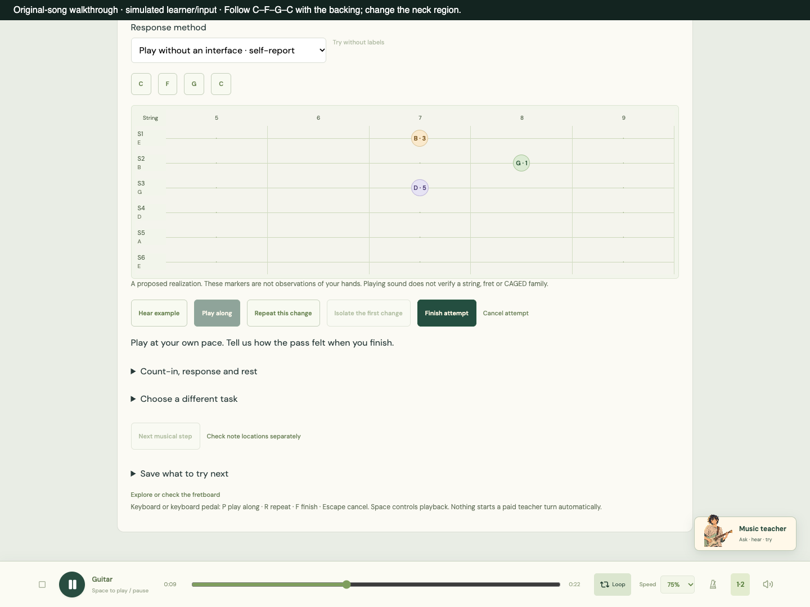

# Guitar homework walkthrough

Use the included original C–F–G–C study. No imported score or commercial recording is needed.

[Watch the 58-second walkthrough](media/guitar-homework/walkthrough.mp4) or open the [animated preview](media/guitar-homework/preview.gif). This is an actual isolated-browser recording of the app with simulated actions and synthetic input, labeled throughout. The video has no audio track. It does not show a person playing or qualify interface latency.

The capture retains an unassessed first attempt, a supported F→E retry, a local-guide response and a restored bookmark. [Media provenance](media/guitar-homework/README.md) records the capture and checksums.

1. Open **Studio → Fretboard homework** and start the 15-minute workload. Keep self-report selected. The duration is a suggested amount of work, not a countdown.
2. Read **Find C**. Use **Hear example**, then **Play along** or **Try without labels**. Find another C on the guitar. **Finish attempt** offers felt secure, needs another pass, not sure or skipped. These are reports, not verified pitch or location answers.
3. Move to the C-major fragment and its neighboring family. Pick the notes and say root, third and fifth. The selected fragment is a playable landmark; a full movable C/G grip is not required. Optional coordinate checks assess location separately.
4. Play the progression in the current region, then the suggested second region. **Repeat this change** isolates a change before returning to the progression. The source, backing tracks and harmonic timing remain intact.
5. Compare G with G7, then play F→E into Cmaj7. The live connection task, when used, requires a descending semitone; simply playing any F followed by any E is insufficient.
6. Optionally choose live input in this same assignment. Explicitly connect a clean interface channel. A weak or ambiguous response is **could not assess**, not an incorrect answer. Pick the chord tones individually and retry. Audio still cannot establish the chosen fret or string.
7. Choose **Save for next time**. The Studio bookmark names the step and region, with passage and tempo retained. Reload does not reopen a device. An interrupted live response remains recorded.

The task controls support P for Play along, R for repeat, F for finish and Escape for cancel when focus is outside text entry or a dialog. Space uses the existing play/pause transport. Keyboard-emulating pedals can use those keys. Explicit help remains available and records support before revealing information.

For reproducible browser demonstrations, `tests/guitar-homework.spec.ts` uses an isolated browser and explicitly synthetic input through the real capture worklet. Such a capture demonstrates software behavior, not a person playing successfully or measured hardware latency. Keep that label visible in published media.

## Reproduce the capture

Start `npm run dev -- --port 5419 --strictPort`, then run `npm run demo:homework -- .local/homework-capture` in another terminal after installing Playwright Chromium. The script creates a fresh browser profile, uses only the original study, asserts playback and chord-following, and writes screenshots, a WebM and local authored evidence. It never visits the user's tabs or calls hosted inference. `TTP_CAPTURE_ORIGIN` can point to a different local development port.
