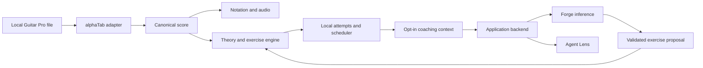

# TabToPitch implementation plans

## Current direction: play a progression anywhere on the neck

The October 30 revision makes this sequence central: choose a passage, confirm its chords, move the accompaniment, add an extension, compare the result, and practice a connection to the next chord. Note names lead; octaves remain optional. The implemented contracts are in [architecture](architecture.md), [curriculum](curriculum.md), and the [demo](demo.md).

The accepted delivery order is harmony engine → progression UI/playback → arrangement-agent evaluation → voicing-ranking evaluation → evidence and demonstrations. The engine supports extended harmony, contextual partial voicings, explicit constraints, and deterministic grading. Derived scores preserve the imported source and use the existing player. The bounded agent interprets requests and selects engine-generated candidates; a separate experimental model orders valid one-change candidates.

The frozen [agent protocol](../research/arrangement-agent/protocol-v2.md) and [ranking protocol](../research/voicing-ranking/protocol.json) own experimental settings. Original experiments remain unchanged. Actual results, deployment boundaries, and outstanding physical-device and learner checks are recorded in [verification](verification.md) and [release gates](release-gates.md). Neither a valid proposal nor improved recovery of a recorded voicing establishes better teaching.

## Original accepted plan: learn the fretboard through the songs you play

> Product revision, 2026-10-29: note names and chord shapes now lead the experience; octave labels and exact-pitch practice are optional. Understand mode explores notes across octaves and derived three-string triad voicings. The plan below preserves the earlier design; current behavior and measurement limits are defined in [architecture](architecture.md) and [curriculum](curriculum.md). The separate [fretboard-intent experiment](../research/practice-intent/protocol.md) evaluates language control without changing the app’s deterministic music or grading.

## 1. Product direction and differentiation

Build a standalone guitar practice application for intermediate players who can follow tabs but struggle to name notes, recognize intervals, and explain chord shapes.

**The product promise: play a familiar passage, understand its notes, then use that knowledge somewhere else on the neck.**

The defining interaction remains the original PRD’s idea: show scientific pitch notation, such as `B2`, directly on the correct guitar string at the correct rhythmic position. Fret hints gradually become optional. Theory lessons grow from the notes the player is already playing.

The first release combines an accurate player, focused theory exercises, and a Forge-powered practice agent. It is sized for one engineer working with coding agents. Anyone can use the local player; invited testers can enable cloud coaching.

### What the research changes

| Comparable                | Existing capability                                                                           | Implication for TabToPitch                                                                                    |
| ------------------------- | --------------------------------------------------------------------------------------------- | ------------------------------------------------------------------------------------------------------------- |
| Songsterr and Guitar Pro  | Multitrack notation, playback, practice controls; Songsterr also advertises AI transcription. | Import their supported file formats and build on the arrangement. Transcription is outside the first release. |
| Soundslice                | Synchronized notation, visual fretboard, and pitch-name display.                              | Pitch labels alone are insufficient differentiation.                                                          |
| Yousician                 | Performance feedback, adaptive speed, looping, and guided practice.                           | A practice recommendation or changing tempo is already familiar.                                              |
| Guitar Mentor and Strumly | Vendor-advertised song-aware AI coaching and adaptive practice.                               | An AI chat panel is insufficient differentiation.                                                             |

Sources: [Songsterr](https://www.songsterr.com/new), [Guitar Pro](https://www.guitar-pro.com/c/10-guitar-pro-new-features), [Soundslice pitch names](https://www.soundslice.com/help/en/player/advanced/226/showing-pitch-names/), [Yousician practice modes](https://support.yousician.com/hc/en-us/articles/201558362-Practice-and-Play-modes-in-guitar), [Guitar Mentor](https://guitarmentor.in/), [Strumly](https://strumly.suedeai.ai/docs/what-is-strumly). These are documented product capabilities, not independent quality assessments.

**Our differentiation hypothesis is the complete learning sequence:**

1. Read pitch names inside a song’s original tablature.
2. Inspect the musical explanation, with references to the actual notes.
3. Practice one concept with progressively fewer hints.
4. Answer a new question involving another passage or neck position.
5. Return later and check what was retained.

The potential advantage is the accumulated relationship between **song passages, musical concepts, exercises, and observed recall**. Validate that advantage with learners before describing it as a moat.

The attachment’s guarantees of permanent mastery, threefold retention, exact camera-based diagnosis, and universal file compatibility are removed. Music practice research supports investigating varied practice, but does not validate this specific interface or its proposed fading schedule. [Carter and Grahn, 2016](https://www.frontiersin.org/journals/psychology/articles/10.3389/fpsyg.2016.01251/full)

## 2. Product experience and learning contracts

### The first session

A player imports a Guitar Pro file or opens an original demonstration song. The app selects a fretted guitar track and displays its tuning and capo.

The player sees pitch names in rhythm, with optional fret hints. They select a short passage, slow it down, and loop it. Selecting a note or chord opens its explanation.

For the PRD’s example:

**String/fret coordinates → B2, D3, G3, D4 → G major with B in the bass → G/B.**

The app can then ask the player to identify B2, find the same pitch elsewhere, or identify its role in the chord. A later question uses another position or passage.

### Three modes

| Mode           | Primary activity                 | Interface                                                                                           |
| -------------- | -------------------------------- | --------------------------------------------------------------------------------------------------- |
| **Play**       | Follow and rehearse the song.    | Score, transport, track selection, loop, speed, metronome, count-in, mute/solo.                     |
| **Understand** | Inspect a selected musical idea. | Note identity, physical position, intervals, supported chord interpretation, and audition controls. |
| **Practice**   | Complete one focused exercise.   | A short instruction, appropriately masked score, answer controls, feedback, and next task.          |

Desktop uses a large score viewport with an inspector opened on demand. Mobile uses horizontal notation, persistent transport, and a bottom sheet for secondary controls. Portrait remains fully usable.

Use readable text and measured notation spacing. Essential information must not depend on hover or color. Keep color meanings stable; do not automatically change the palette’s meaning as the learner progresses. The fretboard is supplementary, rather than a permanently competing visualization.

### Learning progression

Start with pitch names and octave recognition, then exact-pitch locations, intervals, triad construction and inversions, and finally scale degrees under an explicitly selected key.

Include a reversible major/minor triad experiment in Understand mode. It creates an auditionable derived example and preserves the imported score. If a voicing contains duplicated thirds, the transformation must account for every affected note.

The first release contains four graded exercise families:

| Exercise                    | Question and grading                                                                                                                                  | Information hidden                                     |
| --------------------------- | ----------------------------------------------------------------------------------------------------------------------------------------------------- | ------------------------------------------------------ |
| **Name the note**           | Identify pitch class; an advanced setting also requires octave. Accept equivalent enharmonic answers for sound-identification tasks.                  | Pitch label and answer-revealing inspector content.    |
| **Find the same pitch**     | Choose another string/fret producing the exact same sounding pitch, including octave. Accept every valid alternative within the configured fretboard. | Alternative-location markers and their labels.         |
| **Name the interval**       | Identify a simple interval between two eligible pitches. Show direction separately; grade quality and number from validated spelling.                 | Interval annotations and explanatory diagrams.         |
| **Identify the triad role** | Identify root, third, or fifth within an unambiguous, validated major or minor triad.                                                                 | Role labels, role colors, and explanatory answer text. |

Initially, exercises use stable, unbent fretted notes with known tuning and capo. Supported playback is broader than exercise eligibility: an imported harmonic or ambiguous chord can play correctly without becoming a graded question.

### Adaptation and measurement

The baseline scheduler is deterministic and works offline.

- Progress from supported practice to unassisted recall after three correct first responses across at least two question variants.
- A wrong answer or reveal restores support for the next attempt.
- Change hints between attempts, never unexpectedly during a playing passage.
- Schedule successful concepts for review after one, three, and seven days.
- Hold out pitch/string/position combinations from the current practice block for transfer checks.
- Treat these thresholds as versioned product defaults to test, not established educational constants.

Record first-answer correctness, response time, hints, reveals, interruptions, task type, and whether the question was practiced, held out, or delayed.

**Screen answers measure knowledge recall.** Playing along without microphone assessment remains self-reported. Keep these outcomes separate, and include an optional “put the screen down and play” challenge with an explicitly self-reported result.

Primary learning measures are delayed unassisted accuracy and performance on held-out questions. Report reveal and abandonment rates alongside accuracy so selective completion cannot masquerade as improvement.

## 3. Engineering architecture and interfaces

### Application structure

Use a standalone repository with:

- React, TypeScript, Vite, Zustand, and accessible Radix primitives.
- A browser-independent TypeScript music and exercise engine.
- alphaTab for import, engraving, synthesis, and playback.
- Tonal for interval and chord utilities, with application-owned interpretation rules.
- IndexedDB for local files, settings, exercises, and attempts.
- A small Node/Fastify backend for invited coaching, credentials, quotas, and tracing.
- Vitest for engine tests and Playwright for browser integration.

Deliver the web app and backend as one OCI container. Default beta hosting is a Render CPU web service with managed PostgreSQL for invitation, session, and quota state. Learner progress remains on-device. Keep deployment portable; Forge supplies the AI services.

### Correct the renderer before building the product around it

Pin alphaTab 1.8.4 for the initial feasibility milestone and use its official Vite integration. The current glyph implementation measures fret text before laying out the score. Wider pitch labels need to enter that measurement pipeline. [alphaTab installation](https://alphatab.net/docs/getting-started/installation-vite), [glyph source](https://github.com/CoderLine/alphaTab/blob/v1.8.4/packages/alphatab/src/rendering/glyphs/NoteNumberGlyph.ts#L40-L138)

Implement a small, upstreamable source patch supporting serializable per-note presentation overrides:

- Primary label.
- Optional secondary hint.
- Reserved label dimensions.
- Visibility state.

Keep theory computation outside the patch. Preserve stock rendering when no override exists. Carry presentation data through worker serialization; do not pass functions across worker boundaries.

Reserve a stable label envelope during each exercise so hiding a hint does not move the notation. Existing rhythm, bends, slides, ties, and harmonic symbols retain their engraving behavior.

This is a release gate: dense notation, articulation placement, wrapping, and hit testing must work before the broader UI proceeds. A post-layout SVG replacement is not the fallback.

### Canonical music model

Separate the following concepts:

| Type                 | Responsibility                                                                                                                                         |
| -------------------- | ------------------------------------------------------------------------------------------------------------------------------------------------------ |
| `ScoreDocument`      | Source hash, importer version, tracks, staves, voices, tuning, capo, tempo and meter maps.                                                             |
| `NoteEvent`          | Stable source identity, score position, duration, written spelling, sounding pitch, physical position where applicable, and independent articulations. |
| `PlaybackOccurrence` | A particular traversal of a score event through repeats and alternate endings.                                                                         |
| `AnalysisAnnotation` | Derived interpretation, supporting note IDs, alternatives, support status, and analysis version.                                                       |
| `ExerciseDefinition` | Source references, eligible answers, masking policy, constraints, and generator version.                                                               |
| `PracticeAttempt`    | Immutable response evidence, hint state, timing, outcome, and evidence source.                                                                         |

Rendering bounds live in a separate layout index. Resizing cannot change musical identity.

Key invariants:

- Preserve physical string order. Never sort tuning values.
- Keep written pitch, sounding pitch, and fret position separate.
- Apply capo and transposition once through the adapter.
- Preserve fractional bend curves, pre-bends, releases, ties, and concurrent effects.
- Derive sounding harmony from overlapping note durations across voices, not merely adjacent beat objects.
- Keep percussion and non-fretted instruments distinct from guitar coordinates.
- Represent ambiguous harmony as alternatives or unavailable analysis.
- Preserve imported spelling where valid; handle octave boundaries correctly for spellings such as B♯ and C♭.

alphaTab’s natural-harmonic and capo behavior differs from the attachment’s reference code. Adapter fixtures must verify its sounding-pitch calculation rather than reconstructing every technique with `tuning + fret`. [Pitch implementation](https://github.com/CoderLine/alphaTab/blob/v1.8.4/packages/alphatab/src/model/Note.ts#L631-L680)

Other tracks remain available for playback and optional harmonic context. Their presence does not establish a single “true band chord.”

### Player reliability and persistence

One controller owns the alphaTab lifecycle. Playback events determine transport state; React does not become the audio clock.

Handle file replacement races, audio unlocking, seek/loop continuity, repeat occurrences, resize, background/resume, and disposal. Use indexed event lookup rather than scanning every note on each playback update.

Cache versioned app assets, fonts, and SoundFonts for offline use. Install updates between sessions. Provide local progress export, import, and deletion; handle storage quota failures without losing the current session.

Import failures distinguish malformed files, unsupported content, and partially available analysis. The initial supported formats are `.gp3`, `.gp4`, `.gp5`, `.gpx`, and `.gp`, qualified by fixtures rather than an unconditional compatibility promise.

### Backend contract

Keep the initial public API small:

- `POST /api/invitations/exchange`: exchange a revocable invitation for a secure session.
- `POST /api/coach/next`: submit bounded practice context and receive a validated recommendation.
- `DELETE /api/session`: end cloud-coach access.
- `GET /healthz`: deployment health.

Use shared versioned schemas. The coach response contains an eligible exercise ID, allowed player settings, evidence references, explanation, and policy/model versions. It never supplies the grading key.

Store hashed invitation credentials and persistent quota counters. Keep Forge keys server-side. Add schema migrations and a tested database backup/restore procedure.

## 4. Agent behavior, Forge integration, and later ML

### A bounded practice agent

The agent runs between attempts. Its job is to choose and explain the next useful exercise.

Its tools are deliberately narrow:

- Inspect the selected phrase and verified facts.
- Read recent recall evidence.
- List eligible exercises.
- Inspect an exercise’s learning objective and constraints.
- Propose a practice configuration.

A typical interaction is:

> “You identified these notes with fret hints, but missed B2 without them. Try finding B2 on another string before replaying this passage.”

The application checks that this statement matches recorded evidence and that the selected exercise is valid.

The agent cannot rewrite the source score, invent pitches, generate executable tools, grade answers, or infer mastery from playback. Changes to the current loop, track, or hint policy apply when the learner starts the proposed exercise.

Use a bounded tool loop, request deadline, token allowance, per-invitation quota, and global spending limit. Invalid output, unavailable models, timeout, or exhausted quota returns the deterministic local recommendation.

### Cloud boundary

Cloud coaching is opt-in. Send only the selected normalized passage fragment, verified facts, eligible exercise descriptors, and necessary recent attempt summaries.

Exclude raw Guitar Pro files, filenames, lyrics, and identifying song metadata by default. Explain that selected context reaches the application server and Forge, including configured traces. Learning-data contribution is a separate opt-in.

Imported text is untrusted content, never agent instructions. Trace payloads use an explicit allowlist.

### Forge components

| Forge capability            | Concrete demonstration                                                      |
| --------------------------- | --------------------------------------------------------------------------- |
| **Serverless Inference**    | The agent selects and explains an eligible exercise.                        |
| **Agent Lens**              | Inspect the conversation, model calls, tools, failures, latency, and usage. |
| **Weave Evaluations**       | Replay versioned coaching scenarios and compare prompt/model changes.       |
| **W&B Models and Registry** | Later, reproduce training and promotion of a recall predictor.              |

Use the documented OpenAI-compatible inference endpoint. Begin capability testing with `openai/gpt-oss-20b`, verify account availability and tool support through model discovery, and pin the deployment model. If qualification fails, the local coach remains available while the cloud feature stays disabled. [Inference API](https://docs.coreweave.com/products/inference/serverless/api-reference)

Instrument Agent Lens with the Forge SDK. Use Weave Evaluations for offline replay, correlating results through practice-session, prompt, policy, and model versions. Do not assume ordinary Weave calls automatically constitute Agent Lens conversations. [Agent Lens reference](https://docs.coreweave.com/products/agent-lens/reference), [Weave evaluations](https://docs.coreweave.com/products/wandb/weave/guides/core-types/evaluations)

### Later ML: predict recall before adapting instruction

After collecting consented real attempts, train a regularized logistic model predicting **unassisted first-answer correctness**.

Use only information available before the attempt: prior outcomes, time since practice, cue level, exercise type, and deterministic musical complexity features. Separate revealed, interrupted, and abandoned attempts from correct/incorrect labels.

Compare against fixed-difficulty and history-based baselines using chronological and learner-held-out splits. Report calibration, Brier score, log loss, and performance by exercise family. Evaluate held-out passages separately.

Log dataset versions, split manifests, features, experiments, and model artifacts in W&B. Run the candidate in shadow mode, then promote a pinned artifact only after a useful held-out result. Serve this small model on CPU.

Synthetic attempts can test the pipeline; they cannot demonstrate better learning. Better recall prediction also does not establish better teaching. That requires a prospective comparison of practice policies.

### Deferred capabilities

Preserve clear expansion paths for circle-of-fifths exercises, constrained triad movement, full-phrase refingering, functional harmony, and vocal-to-guitar mapping.

Microphone assessment comes later, beginning with calibrated single-note exercises and explicit uncertainty. Camera work starts with observed hand-region assistance. The attachment’s exact fingering and biomechanical diagnoses are not supported by its proposed implementation. Basic Pitch is a transcription model, while MediaPipe hand detection can block the UI unless moved off the main thread. [Basic Pitch](https://github.com/spotify/basic-pitch-ts), [MediaPipe documentation](https://developers.google.com/edge/mediapipe/solutions/vision/hand_landmarker/web_js)

## 5. Delivery milestones and acceptance gates

| Milestone                               | Deliverable                                                                             | Exit gate                                                                                                             |
| --------------------------------------- | --------------------------------------------------------------------------------------- | --------------------------------------------------------------------------------------------------------------------- |
| **1. Musical and rendering foundation** | Pinned importer, canonical model, measured pitch labels, original fixtures.             | Correct pitches and readable dense notation in desktop and mobile layouts.                                            |
| **2. Complete local player**            | Import, transport, mixer, loops, speed, tuning/capo display, offline storage.           | A supported song can be practiced through without transport, persistence, or layout failures.                         |
| **3. Learning product**                 | Understand mode, four exercise families, masking, baseline scheduling, delayed review.  | Every graded answer has deterministic evidence; reveals and self-report cannot count as unassisted success.           |
| **4. Forge agent beta**                 | Invitation access, bounded coaching, quotas, Agent Lens traces, Weave regression suite. | Invalid proposals are rejected, cloud failure falls back cleanly, and each recommendation references actual evidence. |
| **5. Learner pilot**                    | Observed sessions and a matched-passage comparison against the conventional player.     | Assess usability, delayed recall, and transfer separately; use results to revise the curriculum.                      |
| **6. Learned adaptation**               | Recall predictor, experiment lineage, shadow evaluation, controlled promotion.          | Real held-out evidence supports deployment; otherwise retain the baseline.                                            |

For a solo engineer, these are dependency gates rather than promised calendar dates. Coding agents can work in parallel on fixtures, isolated UI components, and evaluation cases after the shared contracts are frozen. The engineer owns integration and musical correctness.

### Required verification

- **Music:** original PRD example, alternate and reentrant tuning, capo, transposition, enharmonic octave boundaries, harmonics, fractional bends, ties, multivoice sustain, repeats, alternate endings, and tempo changes.
- **Rendering:** dense sixteenths, tuplets, full chord stacks, long labels, articulation collisions, wrapping, zoom, and phone portrait/landscape.
- **Learning:** no answer leakage, all valid alternative positions accepted, ambiguous material excluded, correct retry behavior, delayed-review scheduling, and held-out question selection.
- **Agent:** invented references, unsupported claims, prompt injection in metadata, invalid settings, repeated requests, timeout, quota exhaustion, and model unavailability.
- **Delivery:** production worker/worklet assets, offline reload, browser storage failures, migrations, invitation revocation, backup/restore, and rollback.
- **Accessibility:** keyboard transport and selection, visible focus, screen-reader descriptions, touch controls, and reduced motion.

Run unit and browser tests in CI. Validate audio behavior on real Safari/iOS and Chromium/Android devices; browser automation alone does not establish audio quality. Preserve source and license notices for the modified alphaTab distribution and bundled assets.

### The demonstration

Use an original, redistributable song:

**Import → play with pitch labels → inspect G/B → miss a recall question → receive a targeted exercise → answer a different-position question → inspect the corresponding Agent Lens trace → replay a retained coach failure in Weave.**

The later ML demonstration adds a real dataset, training run, held-out evaluation, and deployed artifact. It reports observed outcomes without claiming that a successful demo proves improved guitar playing.

The repository should ship the implementation plan, architecture decisions, fixture provenance, curriculum rules, deployment instructions, and a reproducible demo script. The supplied snippets are design material to replace with tested implementations, not production code to paste wholesale.
