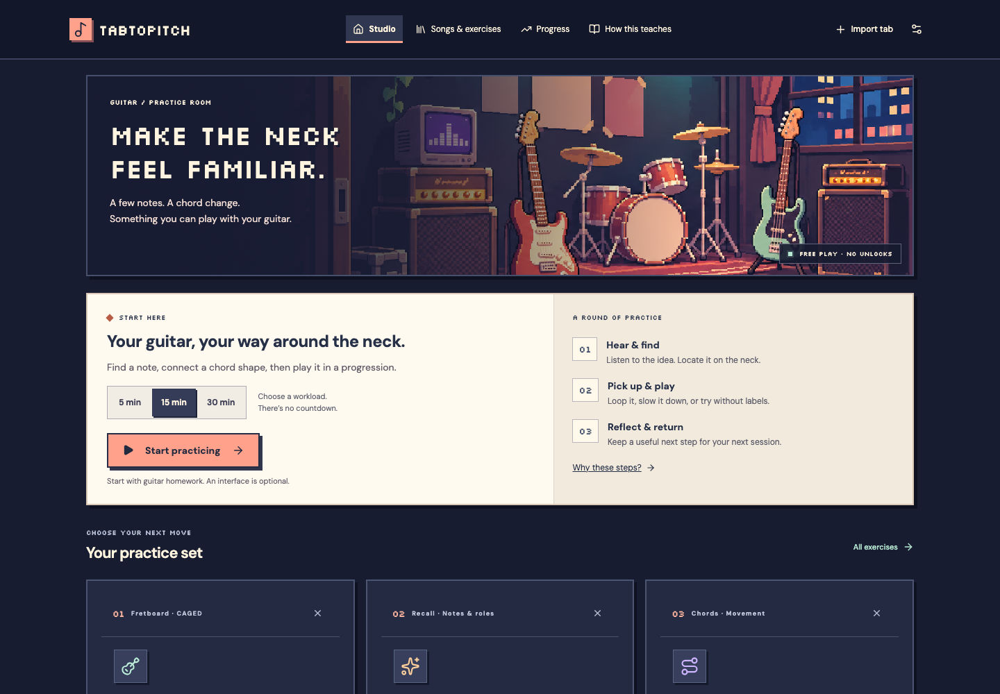
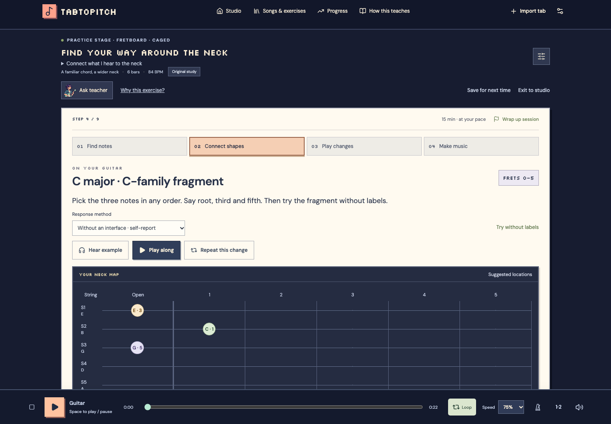
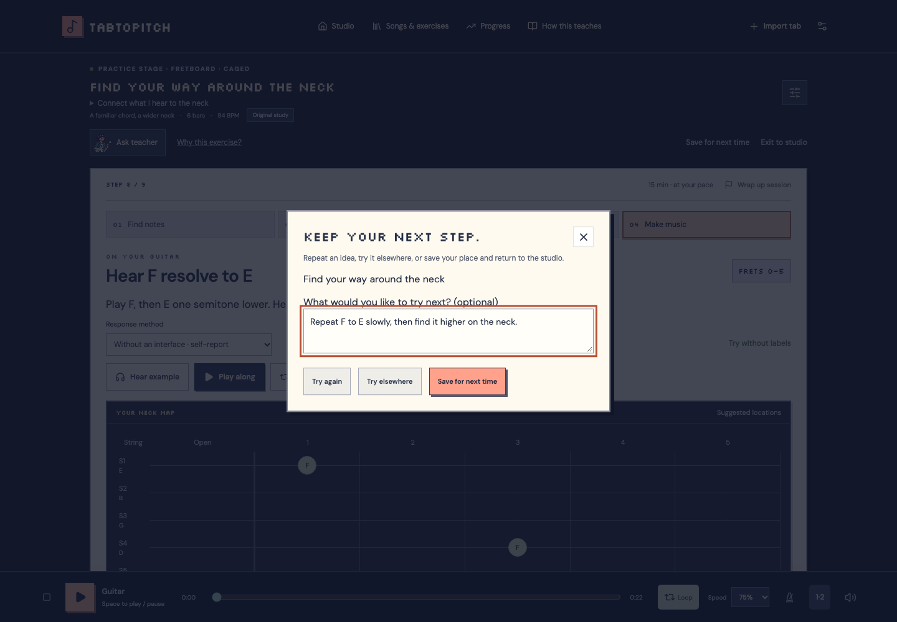

# Pixel practice studio

The Studio now uses an original pixel-art rehearsal room, a navy and cream interface, coral primary actions, and mint accents. Silkscreen marks short game labels; note names and instructions retain DM Sans. Musical role colors remain stable across the app.

## A visible practice route

The starting screen offers one main action, a suggested workload, and the saved next task. Guitar homework follows the assignment already created by the music engine:

```text
Start or resume
  → Find notes
  → Connect shapes
  → Play changes
  → Make music
  → Reflect and save the next step
```

The route is navigable in either direction. Learners can repeat a change, request help, or wrap up early. A workload is a suggestion, not a countdown. Every activity remains available in Songs & exercises.

Each playing task shows a short instruction, its neck region, and playback controls before the diagram. Finishing an attempt focuses the feedback. The next task is named before advancing. Wrap up session opens the shared reflection and bookmark dialog.

Participation is counted from existing immutable events. A step tried is not a correct answer or evidence of mastery. Self-reports, coordinate answers and detected performances retain their separate contracts. Teacher help, first responses, masking, capture and the single player retain their existing owners.

## Application captures

These captures use the original authored study in an isolated Chromium browser. The reflection and self-report are scripted demonstration inputs, not evidence from a learner. No microphone or guitar interface was opened.







## Implementation

The [studio contract](../src/studio/README.md) describes navigation and persistence. [Homework presentation](../src/homework/presentation.ts) groups existing objectives and supplies instructions. The presentation adds no grading history, audio scheduler, model or paid inference call.

[Asset provenance](../public/art/provenance.md) records the built-in image-generation prompts and the bundled Silkscreen license. Artwork is decorative; missing images cannot prevent a practice session. Reduced motion, static notation and keyboard controls remain available.

## Verification

The revised browser session covers starting, self-reporting a difficult attempt, changing practice groups, finishing, saving a reflection, and resuming after reload on desktop and mobile. Existing regression checks cover help-before-reveal, first-response preservation, uncertain audio, legacy backups, keyboard answers and interrupted input. Browser fixtures do not qualify a physical guitar interface or establish educational effectiveness.

Local checks on 5 November 2026:

| Check | Result |
| --- | --- |
| TypeScript and production build | Passed |
| Unit and contract checks | 466 passed; 2 PostgreSQL checks skipped without an isolated database |
| General browser regressions | 82 passed; 4 duplicate-layout skips |
| Studio session and accessibility checks | 13 passed; 1 duplicate-layout skip |
| Guitar homework | 16 passed |
| Notation renderer | 4 passed |
| Production offline reload | 1 passed |

The isolated walkthrough recorded no page errors. The phone viewport and document width were both 390 pixels. Missing artwork, reduced motion and 200% zoom were exercised in the Studio suite. No new Forge inference or learner study was run.

The original illustrated-studio delivery report remains a dated historical record. Its earlier test counts and worktree integration status do not describe this revision.
