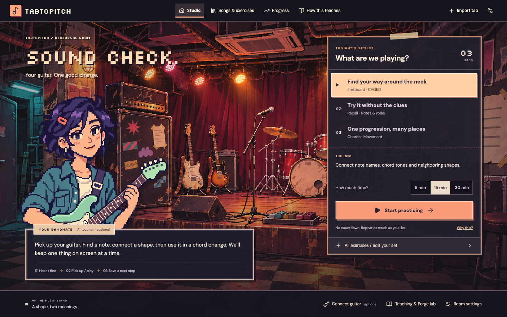
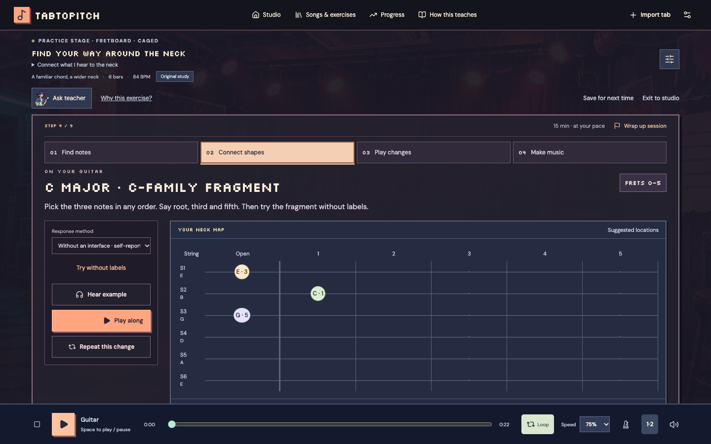
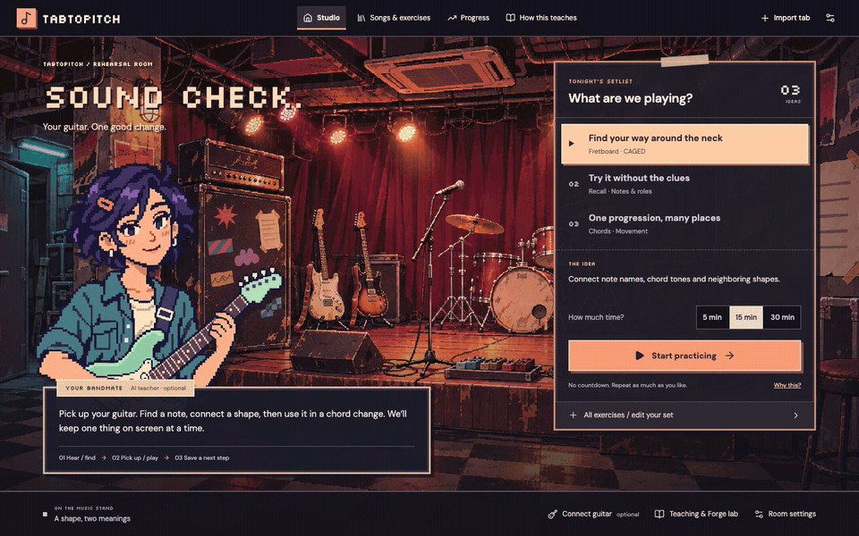
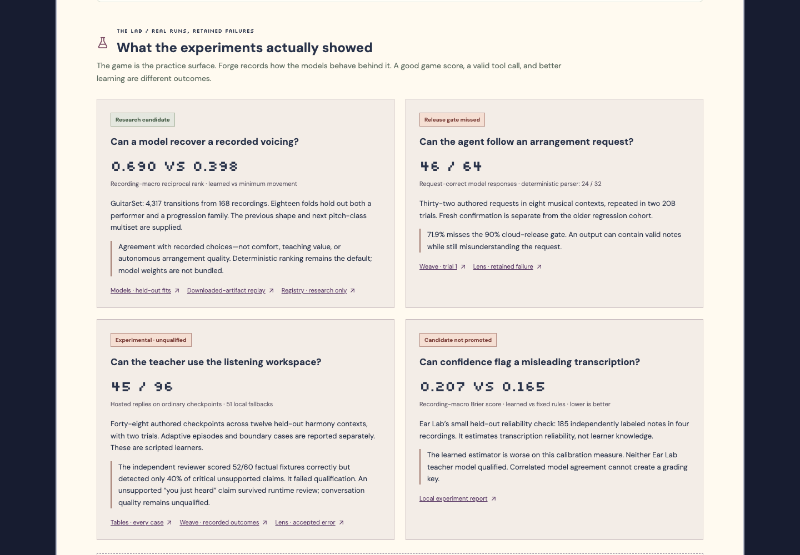

# Live-house practice studio

The Studio is now a full-screen pixel-art game room. A setlist menu selects one activity, a foreground optional bandmate introduces it, and a single button starts or resumes practice. Warm stage lighting, red curtains, battered amplifiers and a darker instrument screen replace the previous banner-and-cards layout. The environment and musician are original assets.

## A visible practice route

```text
Choose an idea from the setlist
  → Find notes
  → Connect shapes
  → Play changes
  → Make music
  → Reflect and save the next step
```

These are navigable groups, not compulsory levels. Learners can repeat a change, ask for help, skip a group, or wrap up early. Workloads remain 5/15/30-minute suggestions without countdowns or unlock requirements. The library edits the practice set; room settings can hide the bandmate.

Desktop homework places playback and response controls beside the fretboard so all six strings remain visible. Mobile stacks the same controls above it. Instructions and note names retain DM Sans; short game labels use Silkscreen. Stable chord-role colors still describe musical roles, not string identity or correctness.

The teacher, playback, lesson state, live input and assessment retain their existing owners. The bandmate’s room introduction is authored interface text. It is not an inference response or an observation about the learner. Finishing an attempt uses the existing feedback, then the shared reflection and bookmark dialog. A self-report remains a self-report; an uncertain detector result stays unassessed.

## Actual application captures

With the local app running, `node scripts/capture-livehouse.mjs ../livehouse-walkthrough` reproduces the captures. Set `TTP_CAPTURE_ORIGIN` to use another local port.

An isolated Chromium browser used the original C–F–G–C study. The demonstrated response and reflection are scripted; no microphone or interface was opened.









## Forge evidence

The research page now exposes the voicing, arrangement, listening-teacher and Ear Lab results with their denominators, dataset context, limitations and private dashboard links. It distinguishes a hosted reply from a fallback and a research candidate from a qualified release.

The [dated evidence audit](../public/research/notebook/evidence-audit.md) records fresh Lens, Weave, Models, Tables and Registry readbacks, plus local archive checks. It includes the initially failed verification attempts and their resolution. No inference, training, publication or qualification was added by the redesign.

## Implementation and validation

The [studio contract](../src/studio/README.md) owns navigation and persistence. [Asset provenance](../public/art/provenance.md) records the generation prompts and font license. Art remains decorative; missing images, reduced motion and keyboard use must leave the practice flow usable.

Physical guitar-interface latency, Safari/iOS audio and learner effectiveness remain outside these browser checks.

| Check · 5 November 2026 | Result |
| --- | --- |
| TypeScript and production build | Passed |
| Unit and contracts | 466 passed; 2 PostgreSQL checks skipped without an isolated database |
| General browser regressions | 82 passed; 4 duplicate-layout skips |
| Studio, full session, accessibility and evidence links | 17 passed; 1 duplicate-layout skip |
| Guitar homework | 16 passed |
| Notation renderer | 4 passed |
| Offline production reload | 1 passed |
| Forge transport/publication guards | 17 passed with the required TypeScript loader |

The original-song capture recorded no page errors. At phone width, both viewport and document measured 390 pixels. Missing art, reduced motion, 200% zoom and keyboard operation are covered by the Studio checks. The initial plain-Node Forge test invocation lacked the TypeScript import resolver; rerunning with `node --import tsx --test research/forge/*.test.mjs` passed all 17 checks.

The earlier illustrated-studio delivery report remains historical. This change does not add a learning-effectiveness claim, promote a model or qualify a guitar interface.
