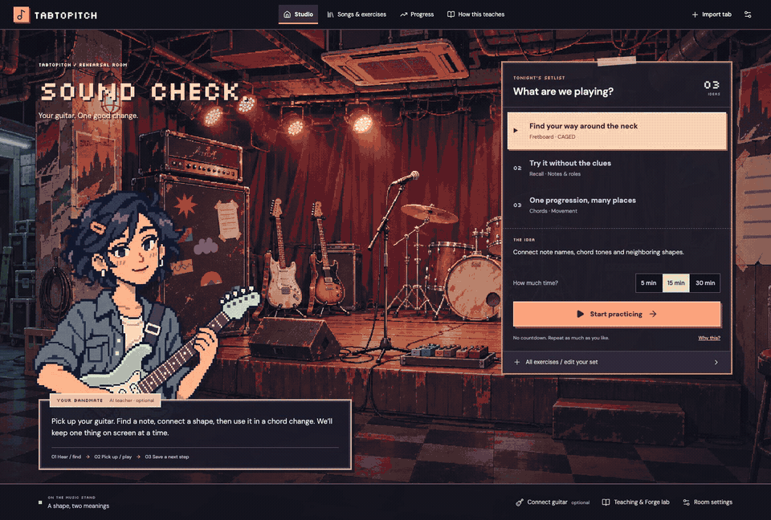

# A playable explanation, followed all the way to Forge

Checked November 5, 2026. The learner and input in this demonstration are scripted. All music is an original study. No private score, recording or real learner history was uploaded.

## What changed in practice

Select a fretboard location and hear its note. Ask why E is the third of C, inspect its role, then return to the guitar. Move a small CAGED fragment into C–F–G–C in two regions. Finish by hearing F descend to E over G7→Cmaj7, choosing another attempt, and saving a return point.

The explanation now uses the selected homework's harmony. Previously the teacher could receive the imported C–F–G–C progression while the task showed G7→Cmaj7. Saving the learner's message also cancelled its own pending cloud reply. Both integration faults were repaired. The wide-screen teacher leaves the instrument usable, and exploration can audition any visible location. Help is recorded before exposure; a self-report and uncertain input remain different evidence.

## Which product ideas were useful?

- [Ableton Learning Music](https://learningmusic.ableton.com/chords/chords.html) puts a playable musical example beside an explanation. Here, selecting a note connects its sound, location and chord role.
- [Melodics Practice Mode](https://support.melodics.com/en/articles/6777027-practice-mode) and [Rocksmith's Riff Repeater](https://news.ubisoft.com/en-gb/article/5XfINjoRmVJgBKR8fGt4EM/rocksmith-accessibility-spotlight) make difficult material smaller and slower. Here, a difficult pass offers a comparison, isolated notes or another attempt without forcing a quiz.
- [Rhythm Doctor](https://rhythmdr.com/) centers a clear musical action. Here, the current task stays central; a fretboard question does not acquire a timing score.
- [Hooktheory](https://www.hooktheory.com/faq) connects harmony to songs. Here, the teacher and workspace must describe the same selected passage.

These are interaction references, not evidence that copying them improves learning. The existing learning library keeps pedagogical studies and application experiments separate.

## What the real calls showed

| Development run | Executed turns | Runtime outcome | Important finding |
| --- | ---: | --- | --- |
| 001 | 1, before inference | Cancelled locally | Saving the learner message invalidated its own request. |
| 002 | 3 | Three local fallbacks; two actor calls | Duplicate JSON key, trailing JSON content, then oversized context. |
| 003 | 1 of 3 planned | Actor and critic accepted one reply | The reply placed E4 at two incorrect coordinates. This is a critical accepted error. The capture then stopped on a storage-read bug. |
| 004 | 3 | One reviewed hosted reply, two fallbacks | The F→E explanation completed. Another proposal failed validation; the last model response reached its output limit. The whole UI flow saved and resumed. |

Run 003 said E4 could be found at string 2/fret 2 and string 3/fret 4. In the supplied standard tuning those positions sound C♯4 and B3. The runtime critic approved the response. A new deterministic guard sends numerical coordinate instructions to verified diagrams instead of accepting common coordinate forms in model prose. That guard has deliberately limited language coverage. The teacher remains experimental and unqualified.

Weave’s automatic `model_success` field describes successful replay execution; `providerSuccess` is the actual hosted-reply outcome. It is 1/3 in the final run.

The final hosted run took approximately 8.4, 20.3 and 27.7 seconds per turn. This is still too slow for an immediate conversational feel. It is suitable only between attempts. A successful fallback is not an actor success, and the keyword checks are not a qualified assessment of explanation quality.

## Inspect the evidence

- [Agent Lens: completed three-turn walkthrough](https://forge.coreweave.com/agent-lens/wandb/tab-to-pitch-public-data-research/conversations/ff9b2e5e-f499-4b84-ad00-2d419ccb4cb1) — 16 actual SDK spans, one conversation, three turns.
- [Weave: replay of those three outputs](https://forge.coreweave.com/wandb/wandb/tab-to-pitch-public-data-research/weave/calls/01a1ad69-9d3e-7ca2-86ed-fd86f566bb90) — three rows, ten replay calls and 24 criterion values; no new actor inference during replay.
- [W&B Table: development comparison](https://forge.coreweave.com/wandb/wandb/tab-to-pitch-public-data-research/runs/connected-homework-development-v1-comparison) — seven observed turns and two unexecuted turns across runs 002–004, with the accepted coordinate error explicitly labeled.
- [Agent Lens: retained critic false approval](https://forge.coreweave.com/agent-lens/wandb/tab-to-pitch-public-data-research/conversations/79178780-d911-40be-a291-b59dc71c20d0) and [its unchanged Weave replay](https://forge.coreweave.com/wandb/wandb/tab-to-pitch-public-data-research/weave/calls/01a1ad65-d3b4-77d7-b126-375748c09c27).
- [Earlier experiments and Models/Registry lineage](./dashboard-tour.md) remain separate. No model was trained or promoted during this UI work.

These turns used direct final responses and validated actions; they did not exercise a multi-step actor-selected tool sequence. Validation spans must not be counted as evidence that the actor chose music tools. Remote span identities, conversation grouping, dataset membership, recorded outputs and criterion values were read back. The comparison table was downloaded and its bytes matched. Across runs 002–004: eight paid calls, six actor and two critic, estimated usage cost $0.00257941. Atomic ledger rounding charged $0.002584. Including preserved historical reservations, the reconciled ledger accounts for $0.222618 of the original $25 authorization. These are usage-based accounting estimates, not an invoice.

## Watch and try

[Full real Forge walkthrough](../../demos/connected-homework/forge-walkthrough.mp4) · [Revised local-guide walkthrough](../../demos/connected-homework/local-guide.mp4) · [Capture provenance](../../demos/connected-homework/provenance.json)

The full hosted capture includes failed replies and waiting time. The shorter local-guide capture shows the revised layout without making cloud calls. Both use synthetic input; silence produces “could not assess.” Screen coordinates and self-reports remain separate from detected sound.

Start in Studio → Continue practicing → Fretboard homework. Select a note, open the teacher, and ask “Why is E the third of C major?” Then choose “Authored connection · G7 → Cmaj7,” compare the two roles, play a pass and save what you want to revisit.

## Application verification

The final application checks passed: 487 unit tests and 138 browser checks across the application, homework, studio, live input, Ear Lab, renderer and offline suites. Type checking and the production build passed. Two database tests and five browser cases remain skipped under their existing environment or capability conditions. The browser checks include delayed teacher replies, reserved-question masking, assistance before audition, both connection endpoints, drawer overlap, video loading and saved-session recovery. Synthetic input does not qualify a physical USB interface or audible playback quality.

Next: improve the teacher's response reliability and latency on new development cases, then requalify on reserved cases with a qualified reviewer. A larger model, a passing UI test or an attractive presentation cannot substitute for that work. Physical interface audio and learner outcomes still require their separate checks.
